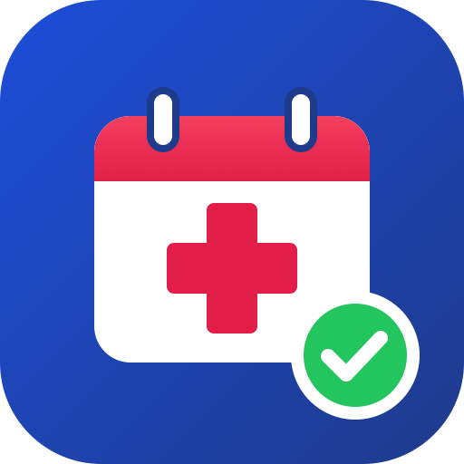

# 🏥 Automatizador de Citas EDUS

<p align="center">
  
</p>

<p align="center">
  Busca y reserva citas médicas en <b>EDUS</b> de la <b>CCSS</b> (Costa Rica) desde tu Mac, con <b>Playwright</b>. Todo local: sin bots, sin nube, sin IA.
</p>

<p align="center">
  <a href="https://python.org"></a>
  <a href="https://playwright.dev"></a>
  <a href="LICENSE"></a>
  <a href="#"></a>
  <a href="#"></a>
</p>

---

## Para quienes buscan una cita

Para todos aquellos que de verdad buscan una cita y el sistema simplemente no les va — los que madrugan a las 5 de la mañana, los que refrescan la página hasta el cansancio y los que ya no saben a quién pedir ayuda: esta herramienta es para ustedes.

---

## 🙏 Agradecimientos

Este proyecto fue generado a partir de la **guía/skill base** de **[jeudytuanisapps/automatizacion-citas-edus-ccss](https://github.com/jeudytuanisapps/automatizacion-citas-edus-ccss)**. Gracias por el excelente trabajo base que hizo posible este script. 🙌

---

## 📋 Tabla de Contenidos

- [Características](#-características)
- [Requisitos](#-requisitos)
- [Instalación](#-instalación)
- [Uso](#-uso)
- [Estructura del Proyecto](#-estructura-del-proyecto)
- [Créditos](#-créditos)
- [Licencia](#-licencia)

---

## ✨ Características

- 🔐 **Credenciales en el Llavero de macOS**: nunca en archivos, variables de entorno ni logs
- 🧩 **Código de seguridad en una ventana nativa**: lo escribes tú; solo se pide de nuevo si EDUS cierra la sesión
- 🔍 **Revisa cupos cada 2 minutos** en la misma sesión (configurable)
- 📅 **Reserva automática** del primer cupo, verificada por el N° de cita en tu listado
- 🚨 **Alarma fuerte** (volumen al máximo, en bucle) al reservar, si EDUS rechaza la cita o cuando pide el código
- 🛑 **Se detiene** si la clave es incorrecta (para no bloquear la cuenta), si ya tienes una cita en los próximos 3 días o si el resultado es incierto (para no reservar dos veces)
- ☕ **Mantiene la Mac despierta** mientras corre

---

## 📦 Requisitos

- **macOS** (usa el Llavero, notificaciones y diálogos nativos)
- **Python** 3.11+
- Una cuenta de **EDUS Citas Web**

---

## 🚀 Instalación

```bash
git clone https://github.com/<tu-usuario>/Automatizador-Citas-Edus.git
cd Automatizador-Citas-Edus

python3 -m venv .venv
.venv/bin/pip install -r requirements.txt
.venv/bin/playwright install chromium

.venv/bin/python edus_local.py --setup   # guarda cédula y clave en el Llavero
```

---

## 💻 Uso

```bash
.venv/bin/python edus_local.py           # busca hasta reservar (Ctrl+C para detener)
.venv/bin/python edus_local.py --ver     # igual, mostrando el navegador
```

| Opción           | Descripción                                                        |
| ---------------- | ------------------------------------------------------------------ |
| `--setup`        | Guardar o cambiar cédula y clave en el Llavero                     |
| `--intervalo N`  | Segundos entre revisiones (default 120)                            |
| `--servicio`     | Código de servicio (default `1` = Medicina)                        |
| `--especialidad` | Código de especialidad (default `1033` = Medicina General)         |
| `--excluir`      | Fechas a ignorar: `DD/MM/AAAA,DD/MM/AAAA`                          |
| `--ver`          | Mostrar la ventana de Chromium                                     |
| `--observar`     | Abrir el cupo y guardar captura de la confirmación, **sin reservar** |

Capturas e imágenes se guardan en `~/Library/Application Support/EdusCitas` (solo accesible por tu usuario).

> Mantén la tapa abierta: el script evita que la Mac se duerma por inactividad, pero no al cerrar la tapa.

### Flujo

1. Inicia sesión en EDUS; suena la alarma y aparece la ventana para escribir el código de seguridad.
2. Abre **Agregar una cita**, elige servicio y especialidad y lee los cupos.
3. Si no hay, espera el intervalo y repite en la misma sesión.
4. Si hay, abre el cupo, presiona **Confirmar Cita** y verifica que el N° de cita aparezca en tu listado.
5. Te avisa con alarma y se detiene.

---

## 📁 Estructura del Proyecto

```
Automatizador-Citas-Edus/
├── edus_local.py      # Buscador y reservador local
├── requirements.txt   # Dependencias Python
├── logo.png
├── LICENSE
└── README.md
```

---

## ⚠️ Notas importantes

- EDUS no permite reservar si ya tienes una cita en los **próximos 3 días**
- EDUS no permite dos sesiones abiertas desde el mismo equipo: detén el script antes de entrar manualmente
- Este proyecto **no está afiliado** con la Caja Costarricense de Seguro Social

---

## 🙏 Créditos

Basado en **[jeudytuanisapps/automatizacion-citas-edus-ccss](https://github.com/jeudytuanisapps/automatizacion-citas-edus-ccss)** y **[Xainner/Automatizador-Citas-Edus](https://github.com/Xainner/Automatizador-Citas-Edus)**.

---

## 📄 Licencia

Este proyecto está bajo la licencia **MIT**. Ver el archivo [LICENSE](LICENSE) para más detalles.
