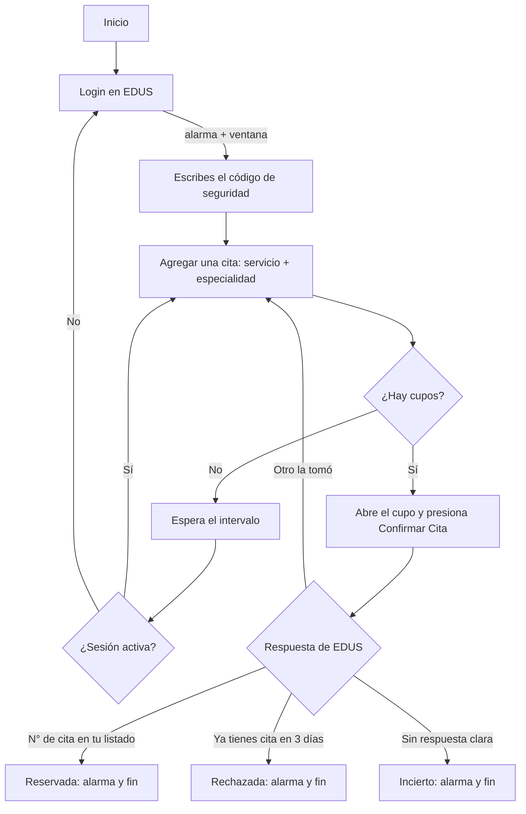

<p align="center">
  
</p>

<h1 align="center">Automatizador de Citas EDUS</h1>

<p align="center">
  Deja tu Mac encendida: busca cupos en <b>EDUS Citas Web</b> (CCSS, Costa Rica), reserva el primero que aparezca y te avisa con una alarma.<br>
  Todo corre en tu computadora: sin bots, sin servidores, sin IA.
</p>

<p align="center">
  
  
  
  <a href="LICENSE"></a>
</p>

---

Para quienes madrugan a las 5 de la mañana, refrescan la página hasta el cansancio y aun así no consiguen cita: esta herramienta hace esa espera por ti.

## Contenido

- [Qué hace](#qué-hace)
- [Inicio rápido](#inicio-rápido)
- [Uso](#uso)
- [Cómo funciona](#cómo-funciona)
- [Avisos](#avisos)
- [Seguridad](#seguridad)
- [Problemas comunes](#problemas-comunes)
- [Créditos](#créditos)

## Qué hace

- **Revisa cupos cada 2 minutos** sin cerrar la sesión, así que solo te pide el código de seguridad una vez (o cuando EDUS la expire).
- **Reserva sola** el primer cupo disponible y confirma que el N° de cita aparezca en tu listado.
- **Suena una alarma** a todo volumen cuando reserva, cuando EDUS rechaza la cita o cuando necesita el código.
- **Se protege a sí misma**: se detiene si la clave es incorrecta (para no bloquear tu cuenta), si ya tienes una cita en los próximos 3 días, o si no puede confirmar el resultado (para no reservar dos veces).
- **Guarda tus datos en el Llavero de macOS**, nunca en archivos.

## Inicio rápido

Necesitas **macOS**, **Python 3.11+** y una cuenta de **EDUS Citas Web**.

```bash
git clone https://github.com/sergiopiedra/Automatizador-Citas-Edus.git
cd Automatizador-Citas-Edus

python3 -m venv .venv
.venv/bin/pip install -r requirements.txt
.venv/bin/playwright install chromium

.venv/bin/python edus_local.py --setup   # una sola vez: cédula y clave al Llavero
.venv/bin/python edus_local.py           # a buscar
```

Cuando suene la alarma, escribe el código de seguridad que aparece en pantalla. Después puedes dejarlo solo.

> Deja la tapa abierta. El script evita que la Mac se duerma por inactividad, pero cerrar la tapa la duerme igual.

## Uso

```bash
.venv/bin/python edus_local.py                    # buscar y reservar
.venv/bin/python edus_local.py --ver              # mostrando el navegador
.venv/bin/python edus_local.py --intervalo 60     # revisar cada minuto
.venv/bin/python edus_local.py --observar --ver   # ver el flujo sin reservar
```

| Opción              | Qué hace                                                       | Default             |
| ------------------- | -------------------------------------------------------------- | ------------------- |
| `--setup`           | Guarda o cambia cédula y clave en el Llavero                   |                     |
| `--intervalo N`     | Segundos entre revisiones                                      | `120`               |
| `--servicio X`      | Código de servicio                                             | `1` (Medicina)      |
| `--especialidad X`  | Código de especialidad                                         | `1033` (Med. General) |
| `--excluir F1,F2`   | Fechas a ignorar (`DD/MM/AAAA`)                                | ninguna             |
| `--ver`             | Muestra la ventana de Chromium (no hagas clic en ella)         | oculta              |
| `--observar`        | Abre el cupo y guarda captura de la confirmación, sin reservar | apagado             |

Detener: `Ctrl+C` en la terminal. Al salir intenta cerrar la sesión de EDUS.

## Cómo funciona



## Avisos

| Situación                                  | Qué pasa                                                    |
| ------------------------------------------ | ----------------------------------------------------------- |
| EDUS pide el código de seguridad           | Alarma + ventana con la imagen (hasta ~2 min)              |
| Cita reservada                             | Notificación + alarma hasta que cierres la alerta; se detiene |
| Ya tienes una cita en los próximos 3 días  | Alarma + alerta; se detiene (EDUS no permite otra)         |
| Clave incorrecta                           | Alarma + alerta; se detiene para no bloquear la cuenta      |
| No pudo confirmar el resultado             | Alarma + alerta para que revises EDUS; se detiene          |

La alarma sube el volumen al 100 % mientras suena y luego lo devuelve a como estaba.

## Seguridad

- **Credenciales**: en el Llavero de macOS (servicio `edus-citas`). No se escriben en archivos, variables de entorno ni en el log.
- **Todo local**: el único tráfico de red es hacia `edus.ccss.sa.cr`.
- **Archivos temporales** (imagen del código, capturas): en `~/Library/Application Support/EdusCitas`, con permisos solo para tu usuario.
- **Sin reservas dobles**: ante cualquier duda tras confirmar, se detiene en vez de intentar otro cupo.

Para borrar tus datos: `security delete-generic-password -s edus-citas` (dos veces: cédula y clave) y elimina la carpeta anterior.

## Problemas comunes

| Síntoma                                         | Solución                                                                 |
| ----------------------------------------------- | ------------------------------------------------------------------------ |
| "Ya existe un usuario logueado en este equipo"  | El script cierra la sesión anterior solo; si entras a EDUS a mano, detén el script primero |
| "El Código de Seguridad es inválido"            | Vuelve a escribirlo; el script reintenta hasta 5 veces                   |
| La ventana del código aparece cada 2 minutos    | Nadie la respondió; mientras no la respondas, no revisa cupos             |
| Dejó de revisar al cerrar la tapa               | macOS se durmió; deja la tapa abierta                                    |

## Estructura

```
edus_local.py      Buscador y reservador
requirements.txt   playwright, pillow, keyring
logo.svg           Logo (logo.png: versión 512 px)
```

## Créditos

Basado en [jeudytuanisapps/automatizacion-citas-edus-ccss](https://github.com/jeudytuanisapps/automatizacion-citas-edus-ccss) y [Xainner/Automatizador-Citas-Edus](https://github.com/Xainner/Automatizador-Citas-Edus).

Este proyecto **no está afiliado** con la Caja Costarricense de Seguro Social. Úsalo con responsabilidad: un cupo que reservas y no usas es un cupo que otra persona necesitaba.

## Licencia

[MIT](LICENSE)
